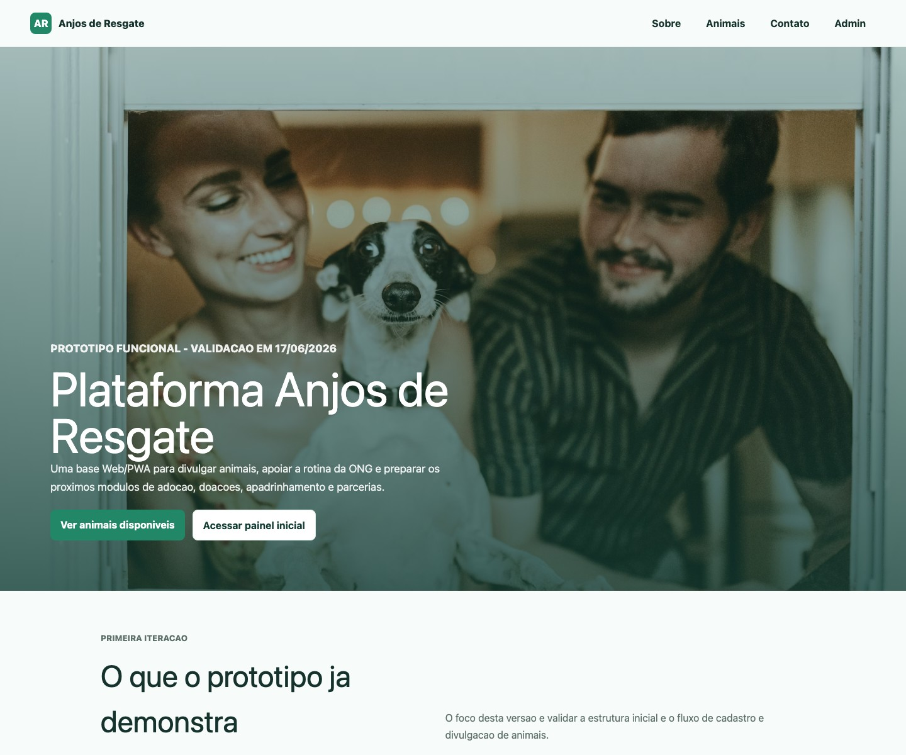
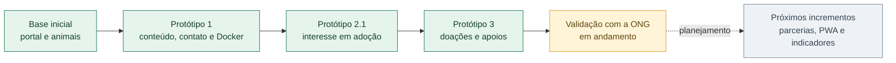
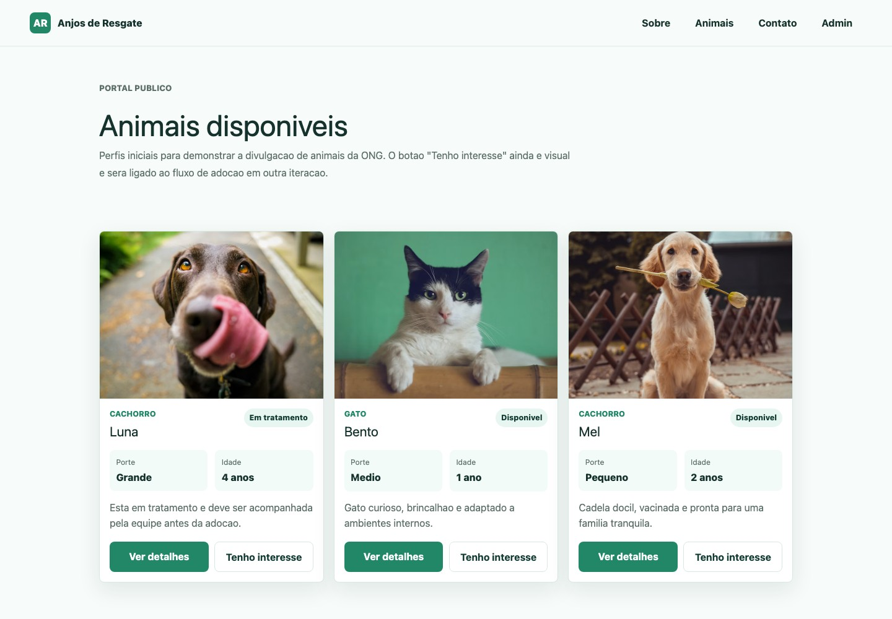
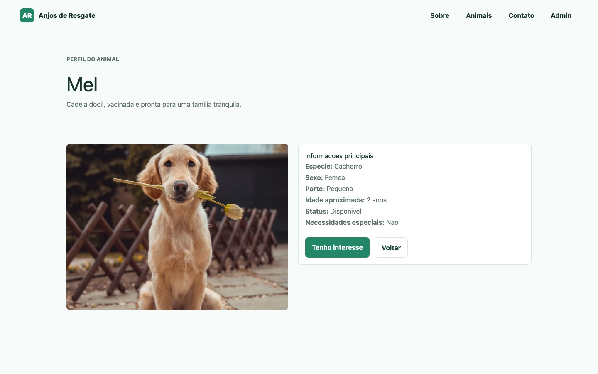
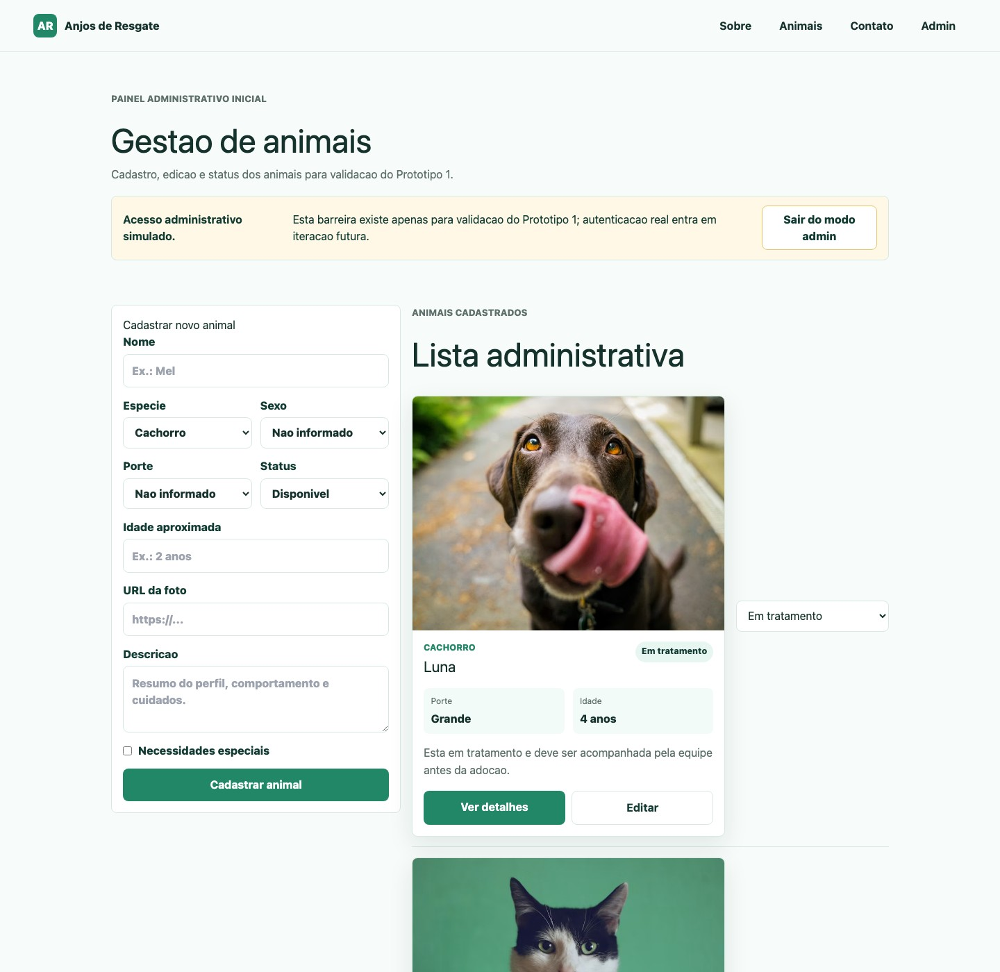
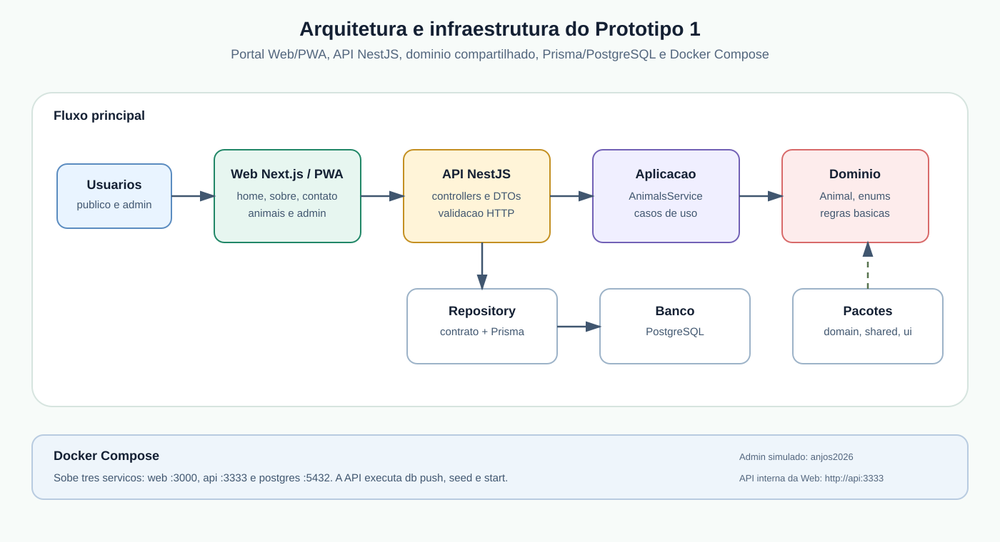

<p align="center">
  
</p>

<h1 align="center">Plataforma Anjos de Resgate</h1>

<p align="center">
  Plataforma Web/PWA construída com a ONG Anjos de Resgate para apoiar a
  divulgação de animais, o interesse em adoção e a organização de campanhas,
  doações e apadrinhamentos.
</p>

<p align="center">
  <a href="#visão-geral">Visão geral</a> ·
  <a href="#impacto-social">Impacto social</a> ·
  <a href="#o-que-já-foi-implementado">Entregas</a> ·
  <a href="#conheça-o-protótipo">Protótipo</a> ·
  <a href="#equipe-e-parceria">Equipe</a> ·
  <a href="#execute-localmente">Executar</a> ·
  <a href="#demo-remota">Demo remota</a> ·
  <a href="#participe-da-validação">Participar</a>
</p>

<p align="center">
  
  
  
  
</p>

> **Estado em 15 de outubro de 2026.** O Protótipo 3 está implementado e a
> demo remota protegida está ativa no Render, com CI aprovado e verificação
> pública de saúde e proteção HTTP. A validação formal com a ONG e a definição de privacidade,
> autenticação e implantação operacional continuam pendentes. Planejamento não
> é tratado como evidência de conclusão.

---

## Visão geral

A plataforma aproxima uma necessidade concreta da **ONG Anjos de Resgate**, de
São Sebastião do Paraíso/MG, das atividades de ensino, pesquisa e extensão da
**Universidade Federal de Lavras (UFLA)**. O desenvolvimento ocorre em
incrementos curtos, demonstrados à ONG para que requisitos e prioridades sejam
revisados a partir do uso do protótipo.

| Para a comunidade | Para a ONG | Para formação e pesquisa |
| --- | --- | --- |
| Acesso mais organizado a animais, formas de contato e oportunidades de apoio. | Apoio à divulgação, ao registro de interesses e à organização de campanhas e apoios. | Cenário real para formação em Engenharia de Software e estudo de IA aplicada a decisões arquiteturais. |

### Princípios do projeto

- **Necessidade antes da tecnologia:** cada incremento parte de um problema
  validável com a ONG.
- **Entrega incremental:** funcionalidades pequenas, demonstráveis e registradas
  por protótipo.
- **Responsabilidade humana:** interesse não conclui adoção; Pix e registros de
  apoio não processam nem confirmam pagamentos automaticamente.
- **Rastreabilidade:** requisitos, validações, diagramas, evidências e decisões
  arquiteturais são versionados com o código.
- **Simplicidade:** a arquitetura evolui conforme necessidades confirmadas, sem
  antecipar módulos ou infraestrutura sem uso definido.

---

## Impacto social

O trabalho integra pesquisa em IA e Arquitetura de Software a um cenário real
de proteção animal. A plataforma apoia processos de divulgação, adoção, doação,
apadrinhamento, campanhas e gestão, contribuindo para que a organização estruture
informações e amplie sua comunicação com a comunidade.

O impacto esperado não depende apenas da disponibilização de software. Ele
resulta da construção conjunta com a ONG, da validação das rotinas apoiadas e da
preparação de documentação, treinamento e passagem de responsabilidade. A base
modular também permite estudar sua adaptação a outras organizações do terceiro
setor com necessidades semelhantes.

### Por que o projeto é executável?

- parceria em andamento com a ONG Anjos de Resgate;
- projeto de extensão com cronograma e validações periódicas;
- projeto de pesquisa e inovação com bolsa financiada pela **FAPEMIG**;
- infraestrutura acadêmica da UFLA;
- código-fonte, documentação e decisões arquiteturais versionados;
- ambiente reproduzível com Docker;
- previsão de protótipo funcional, treinamento, implantação e registro de
  software.

---

## O que já foi implementado



| Incremento | Entrega demonstrável | Situação |
| --- | --- | --- |
| Base inicial | Página inicial, feed, perfil e cadastro básico de animais | Implementado |
| Protótipo 1 | Página institucional, contato, edição administrativa e execução Docker | Implementado |
| Protótipo 2.1 | Feed para muitos animais, interesse inicial e revisão administrativa | Implementado |
| Protótipo 3 | Upload de fotos, contato por e-mail, campanhas, doações, apadrinhamentos e necessidades por animal | Implementado; validação formal pendente |
| Próximos incrementos | Parcerias, experiência PWA, dashboard, relatórios e gestão administrativa | Planejado; escopo a confirmar |

### Limites atuais

- O código administrativo é **simulado** e não substitui autenticação e
  autorização reais.
- Os endpoints administrativos ainda não possuem autenticação nem limitação de
  requisições. O ambiente Docker restringe as portas ao computador local e não
  deve ser publicado na Internet ou usado com dados reais.
- “Tenho interesse” registra uma manifestação inicial; não aprova nem conclui
  uma adoção.
- Pix é informativo; a plataforma não processa pagamentos.
- Doações e apadrinhamentos dependem de conferência e confirmação humana.
- As validações devem usar dados fictícios até a aprovação de privacidade,
  retenção de dados e permissões.

<details>
<summary><strong>Ver funcionalidades por área</strong></summary>

| Área | Funcionalidades disponíveis no protótipo |
| --- | --- |
| Portal | Início, página institucional, contato e navegação responsiva |
| Animais | Feed compacto, perfil, cadastro, edição, status e upload de foto |
| Interesse em adoção | Formulário público, vínculo ao animal, contagem e revisão administrativa |
| Apoios | Doação geral, campanhas, apadrinhamento e necessidades por animal |
| Gestão de apoios | Registro de doadores, histórico e confirmação ou cancelamento manual |
| Comunicação | Envio SMTP e caixa Mailpit para testes locais |
| Evidências | ADRs, diagramas, manifestos, registros de execução e fichas de validação |

</details>

---

## Conheça o protótipo

| Animais | Perfil e interesse | Administração |
| --- | --- | --- |
|  |  |  |
| [Feed público](http://localhost:3000/animais) | [Detalhe de animal](http://localhost:3000/animais/demo-mel) | [Painel administrativo](http://localhost:3000/admin/animais) |

> Os links locais funcionam após iniciar o ambiente Docker. A
> [galeria para validação](docs/18-prints-telas-prototipo-1.md) reúne as telas,
> seus objetivos e perguntas para discussão com a ONG.

### Arquitetura em uma imagem

<p align="center">
  
</p>

A solução separa **interface**, **aplicação**, **domínio** e **infraestrutura**.
Next.js compõe o portal e o painel; NestJS oferece os casos de uso e a API;
regras de domínio permanecem independentes dos frameworks; Prisma e PostgreSQL
realizam a persistência. Decisões relevantes são registradas em ADRs.

<details>
<summary><strong>Ver stack e organização do código</strong></summary>

```text
apps/
  web/       Next.js: portal público e administração
  api/       NestJS: animais, interesses, apoios, contato e uploads
packages/
  domain/    Entidades e regras independentes de framework
  shared/    Conteúdo, labels e dados compartilhados
  ui/        Componentes visuais reutilizáveis
docs/        Escopo, arquitetura, validações, ADRs e evidências
diagrams/    Diagramas versionados
prompts/     Prompts reutilizáveis para apoio arquitetural
```

**Tecnologias:** TypeScript, React, Next.js, NestJS, Prisma, PostgreSQL,
Tailwind CSS, Vitest, Docker Compose, Markdown e Mermaid.

</details>

---

## Pesquisa, extensão e resultados

O sistema é, primeiro, uma entrega para a parceria com a ONG. Ele também fornece
um cenário real e rastreável para investigar como IA generativa pode apoiar a
evolução arquitetural de sistemas Web sob supervisão humana.

Resultados informados em 2026:

- versões incrementais da Plataforma Anjos de Resgate;
- trabalho sobre a arquitetura lógica de referência **ArcAssist-Web**, aceito no
  WebMedia 2026;
- trabalho sobre o **ArcAssist-Web Bot**, protótipo de apoio a decisões
  arquiteturais, aceito no WBOTS 2026;
- evidências de evolução organizadas por incremento;
- continuidade prevista com PWA, indicadores, implantação, documentação,
  treinamento, novas avaliações e registro de software.

O desenvolvimento do sistema e os experimentos de pesquisa possuem objetivos e
evidências próprios. O uso de IA não substitui a validação da ONG, a revisão dos
pesquisadores nem a decisão dos responsáveis pelo software.

Estão previstos dois materiais audiovisuais: uma demonstração da plataforma com
os fluxos validados pela ONG e uma demonstração do assistente de arquitetura
aplicado à evolução do próprio protótipo. Os links serão adicionados após a
gravação e a revisão do conteúdo.

---

## Equipe e parceria

### Coordenação e orientação

| Participante | Atuação |
| --- | --- |
| **Bento Rafael Siqueira** | Docente, coordenação e orientação |
| **Raissa Barbara Nunes Moraes Andrade** | Docente e orientação |

### Estudantes e bolsistas

| Participante | Atuação |
| --- | --- |
| **Vanusa Rodrigues de Oliveira** | Bolsista financiada pela FAPEMIG |
| **Ycaro Alves de Sousa** | Estudante de graduação bolsista |
| **Maria Júlia Pedroso Pimenta** | Estudante de graduação voluntária |
| **Yasmin das Neves Silva** | Estudante de graduação voluntária |

### Instituições

- **ONG Anjos de Resgate:** parceira social e responsável pela validação das
  necessidades e dos fluxos apoiados.
- **Universidade Federal de Lavras (UFLA):** ambiente acadêmico de ensino,
  pesquisa e extensão.
- **FAPEMIG:** financiamento de bolsa vinculada ao projeto de pesquisa e
  inovação.

Conheça o trabalho da ONG no
[Instagram da Associação Anjos de Resgate](https://www.instagram.com/associacao_anjosderesgate/).

---

## Execute localmente

### Pré-requisitos

- Docker Desktop;
- Git.

### Início rápido

```bash
git clone https://github.com/californi/anjos-de-resgate-platform.git
cd anjos-de-resgate-platform
cp .env.example .env
sh scripts/docker-prototype.sh up
```

| Serviço | Endereço |
| --- | --- |
| Portal | http://localhost:3000 |
| Animais | http://localhost:3000/animais |
| Apoios | http://localhost:3000/apoie |
| Administração | http://localhost:3000/admin/animais |
| Administração de apoios | http://localhost:3000/admin/apoios |
| API/health | http://localhost:3333/health |
| E-mails de teste | http://localhost:8025 |

Código administrativo **apenas para demonstração local:** `anjos2026`.

```bash
# Consultar o ambiente
sh scripts/docker-prototype.sh status

# Acompanhar os logs
sh scripts/docker-prototype.sh logs

# Parar sem apagar os dados
sh scripts/docker-prototype.sh down
```

> `reset` apaga o banco local e o volume de uploads. Consulte o
> [guia Docker](docs/16-execucao-prototipo-docker.md) antes de utilizá-lo.
> Os serviços escutam apenas em `127.0.0.1`. O Compose atual é um ambiente local
> de demonstração, não uma configuração de produção.

### Testes

```bash
pnpm install
pnpm test
```

## Demo remota

O repositorio inclui uma demo gratuita e protegida para validacao remota. O
GitHub Actions executa tipagem, testes, builds e um teste de inicializacao com
512 MiB. O Render usa os resultados dos checks para decidir quando implantar
commits no `main`.

> **Limite deliberado:** a demo usa dados ficticios e memoria temporaria. Nao
> informe dados pessoais ou financeiros; alteracoes podem desaparecer quando a
> instancia reiniciar. A credencial compartilhada nao substitui a autenticacao
> individual prevista para uma implantacao operacional.

Acesse a [demo protegida](https://anjos-de-resgate-demo.onrender.com/) com a
credencial fornecida pelo responsavel. O
[registro da implantacao](docs/26-registro-implantacao-demo-2026-10-15.md)
informa o estado verificado e as pendencias antes da divulgacao. O
[guia de publicacao e CI/CD](docs/25-publicacao-demo-e-cicd.md) explica a
configuracao, os links que devem ser compartilhados e as limitacoes do plano
gratuito.

---

## Participe da validação

Pessoas da ONG, estudantes e colaboradores podem contribuir sem alterar o código:

1. execute o protótipo e siga o [roteiro de validação](VALIDATION.md);
2. registre uma
   [validação funcional](https://github.com/californi/anjos-de-resgate-platform/issues/new/choose),
   um problema ou uma sugestão;
3. descreva a tela, o usuário afetado, o resultado esperado e, quando possível,
   anexe uma imagem;
4. use dados fictícios e não publique informações pessoais nos Issues.

Para contribuir com código ou documentação, consulte o
[guia de contribuição](CONTRIBUTING.md). Mudanças de escopo, autenticação,
pagamentos ou tratamento de dados pessoais devem ser discutidas antes da
implementação.

---

## Documentação

<details open>
<summary><strong>Guias principais</strong></summary>

- [Visão e objetivos](docs/00-visao-projeto.md)
- [Escopo funcional](docs/01-escopo-funcional.md)
- [Arquitetura](docs/02-arquitetura.md)
- [Backlog incremental](docs/03-backlog-incremental.md)
- [Modelo de domínio](docs/04-modelo-dominio.md)
- [Protótipos](docs/05-prototipos.md)
- [Validações com a ONG](docs/06-validacoes.md)
- [Decisões arquiteturais](docs/07-decisoes-arquiteturais)
- [Funcionalidades implementadas](docs/17-funcionalidades-implementadas.md)

</details>

<details>
<summary><strong>Execução, colaboração e reunião</strong></summary>

- [Execução com Docker](docs/16-execucao-prototipo-docker.md)
- [Galeria e roteiro visual](docs/18-prints-telas-prototipo-1.md)
- [Colaboração pelo GitHub](docs/19-repositorio-github-colaborativo.md)
- [Gestão do conteúdo](docs/20-gestao-de-conteudo.md)
- [Diagnóstico e plano de outubro](docs/23-diagnostico-e-plano-2026-10-01.md)
- [Ficha de validação](docs/24-ficha-validacao-ong-2026-10.md)
- [Publicação da demo e CI/CD](docs/25-publicacao-demo-e-cicd.md)

</details>

<details>
<summary><strong>Evidências de evolução arquitetural</strong></summary>

- [Protótipo 1](docs/15-prototipo-1-arcassist-web)
- [Protótipo 2.1](docs/21-prototipo-2-interesse-adocao)
- [Protótipo 3](docs/22-prototipo-3-apoios)
- [Pesquisa e evidências](docs/09-pesquisa-e-evidencias.md)

</details>

---

<p align="center">
  <strong>Tecnologia construída com validação social, documentação e evolução incremental.</strong><br>
  <a href="https://www.instagram.com/associacao_anjosderesgate/">ONG no Instagram</a> ·
  <a href="https://github.com/californi/anjos-de-resgate-platform/issues/new/choose">Enviar feedback</a> ·
  <a href="CONTRIBUTING.md">Contribuir</a>
</p>
