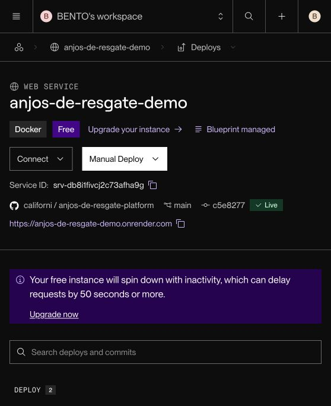

# Registro de implantacao da demo - 15/10/2026

## Objetivo e estado

Disponibilizar o prototipo para validacao remota da ONG e da equipe, com dados
ficticios e credencial HTTP. Decisoes relacionadas: ADR-013 e ADR-014.

Estado neste checkpoint: CI do commit `c5e8277` aprovado, deploy automatico
marcado como `Live` pelo Render e verificacao HTTP publica concluida em
15/10/2026, horario de Sao Paulo.

## Fontes e versoes

| Registro | Evidencia |
| --- | --- |
| Configuracao inicial | Commit `5908aaf5a6bb9aff751ca922901f8cd247c634be` |
| Runtime Node direto | Commit `16ba519079b2f344db765e8a333787c41946354f` |
| Deploy apos checks | Commit `615bc4eb39f61163596e4d081f93762a9f596109` |
| Primeiro deploy | [Render dep-db8i1fqvcj2c73afhbb0](https://dashboard.render.com/web/srv-db8i1fivcj2c73afha9g/deploys/dep-db8i1fqvcj2c73afhbb0) |
| Check com falha | [GitHub Actions 38791614537](https://github.com/californi/anjos-de-resgate-platform/actions/runs/38791614537) |
| Correcao validada | Commit `c5e82777ff277555b7c4e0a4fc966362ff28e066` |
| CI aprovado | [GitHub Actions 38825270206](https://github.com/californi/anjos-de-resgate-platform/actions/runs/38825270206) |
| Deploy automatico ativo | [Render dep-db8mbcek1f9s73c51l60](https://dashboard.render.com/web/srv-db8i1fivcj2c73afha9g/deploys/dep-db8mbcek1f9s73c51l60) |
| URL atribuida | https://anjos-de-resgate-demo.onrender.com/ |

## Eventos confirmados

| Evento | Observacao | Interpretacao e acao |
| --- | --- | --- |
| Criacao no Render | Web Service Docker Free vinculado ao repositorio e a `main`. | Nenhuma confirmacao de uso operacional. |
| Primeiro deploy | Inicio as 15:51:43, GMT-3; duracao 3m24s; build concluido; runtime ultrapassou 512 MiB. | Falha de inicializacao; alterar runtime. |
| Logs de runtime | Dois processos pnpm verificaram dependencias; houve aviso de binario ausente. | Hipotese de sobrecarga de inicializacao, sem medicao por processo. |
| Correcao local | Node direto; saude 200; raiz 401/200; proxy saudavel; 30 animais ficticios. | Comportamento funcional verificado localmente. |
| Memoria local inicial | Uma amostra mostrou 119,7 MiB; limite do container era 3,826 GiB. | Amostra pontual, sem comprovar adequacao a 512 MiB nem uso sob carga. |
| CI em checkout novo | Falha na tipagem por ausencia de `@anjos/domain`; duracao total 29s. | Compilar pacotes compartilhados antes dos consumidores. |
| Conferencia posterior do Render | Painel ainda mostrava somente o deploy inicial com falha. | Nao registrar os commits seguintes como implantados. |
| Sincronizacao do Blueprint | `exe-db8i9unlot8c7391t47g` confirmou `auto-deploy-trigger` atualizado para `checksPass`. | Configuracao recebida; CI ainda precisava ser corrigido. |
| Novo teste local sob limite | Saude, protecao de portal/admin/API e proxy passaram; 30 animais; amostra de 181,6 MiB sob limite de 512 MiB. | Inicializacao verificada nessa imagem local; validar o commit limpo no CI e no Render. |
| CI no commit corrigido | Execucao `38825270206` com `Success`; duracao total 2m23s; job 2m18s. | Checkout limpo, tipagem, testes, builds e runtime aprovados. |
| Runtime no runner | Teste passou com 30 animais e amostra de 105,6 MiB sob limite de 512 MiB. | Evidencia para este commit no runner; nao representa carga da ONG. |
| Deploy apos o CI | Render exibiu `Auto-Deploy`, `Live`, commit `c5e8277`, duracao 1m38s. | Integracao GitHub Actions/Render executada sem deploy manual. |
| Verificacao HTTP externa | `/healthz`: 200 e `{"status":"ok"}`; `/`, `/admin/animais` e `/api/animals`: 401 sem credencial. | Saude integrada e barreira HTTP confirmadas pela URL HTTPS publica. |

Os registros acima sao observacoes desta sessao, apoiadas nos logs e respostas
de ferramentas. Nao houve coleta de carga real nem validacao de usuarios. Os
logs completos permanecem nos provedores; esta tabela e uma transcricao
resumida, nao uma copia integral dos logs.

## Verificacao reproduzivel

```sh
docker build -f Dockerfile.deploy -t anjos-de-resgate:ci .
bash scripts/test-public-demo.sh anjos-de-resgate:ci
```

O teste cria um container descartavel, usa dados e credenciais apenas de teste,
limita a memoria total a 512 MiB e nao publica portas. Ele aguarda a saude da
Web e API, verifica protecao HTTP de portal/admin/API e acesso autenticado ao
portal e aos dados ficticios. O container e encerrado ao terminar.

Para atribuir o resultado a uma versao, executar a partir de checkout limpo e
registrar o SHA e a identidade da imagem. Os cinco arquivos locais pendentes
da interface nao integram os commits de implantacao.

## Resultados da nova verificacao

- Build a partir de checkout limpo: aprovado no CI do commit `c5e8277`.
- Teste de runtime sob 512 MiB: aprovado localmente na imagem
  `anjos-de-resgate:render-fix`, arquitetura `arm64`, identidade
  `sha256:1b5e5013a817f0b062453dd5abadfd19e42935c047bf73aabde97609ae5f373f`.
- GitHub Actions aprovado no commit corrigido: confirmado; 13 testes passaram
  (dominio: 4; API: 8; UI: 1). O teste adicional de UI presente localmente
  permanece fora desse commit e nao integra essa contagem.
- Configuracao `checksPass` efetiva no Render: confirmada no historico de sync.
- Deploy remoto: `Live`, saude publica 200 e rotas protegidas 401 confirmados.
- Navegacao autenticada de um avaliador no ambiente remoto: a realizar com a
  credencial definida pelo responsavel. O teste autenticado automatizado foi
  executado no CI; a senha remota nao foi lida nem copiada para os registros.



Saida da verificacao HTTP externa, sem credenciais:

```text
GET /healthz -> {"status":"ok"} HTTP 200
GET / -> HTTP 401
GET /admin/animais -> HTTP 401
GET /api/animals -> HTTP 401
```

Saida do teste local executado nesta sessao:

```text
PASS health: Web and internal API
PASS authentication: public, admin and API routes require credentials
PASS authenticated page and API proxy: 30 demo animals
Memory snapshot: 181.6MiB / 512MiB
```

O script foi executado com sucesso (codigo de saida 0) e encerrou o container.
A amostra de memoria nao representa um pico nem um ensaio de carga. A imagem
local foi construida antes com alteracoes de interface ainda nao commitadas;
o CI remoto repetiu o teste a partir do codigo do commit corrigido.

Trecho preservado do log do CI, com timestamps UTC:

```text
2026-10-15T23:45:42.9876253Z PASS health: Web and internal API
2026-10-15T23:45:43.0021715Z PASS authentication: public, admin and API routes require credentials
2026-10-15T23:45:43.0920779Z PASS authenticated page and API proxy: 30 demo animals
2026-10-15T23:45:44.6280063Z Memory snapshot: 105.6MiB / 512MiB
```

Origem: `0_Test, build and container.txt` no arquivo de logs da execucao
`38825270206`. SHA-256 do ZIP baixado:
`ec24fa9e630dca89ba7d5aebafb0b33b337892c58cb48cabaa85d759e30d8564`.
O ZIP completo nao e adicionado ao repositorio; o trecho acima preserva os
resultados relevantes sem caminhos do runner nem configuracoes do job.

O CI mostrou aviso sobre a versao interna de Node das actions e aviso de
migracao de `ubuntu-latest`. Eles nao impediram esta execucao. Atualizar as
actions e fixar o runner em uma proxima manutencao, repetindo os checks.

SHA-256 dos scripts usados:

| Script | SHA-256 |
| --- | --- |
| `start-public-demo.sh` | `b736ff18377553d602fd18cbadc916d32b5e260894abbeb278003b17e7f9557f` |
| `test-public-demo.sh` | `481498e4d3d3c037dc9d0454ec8fd83012380052727f3f8bf22da6732993c902` |

## Dados a registrar na conclusao

O SHA implantado, a execucao do CI, o ID do deploy e as respostas de saude e
protecao HTTP estao registrados acima. Atualizacoes somente documentais podem
usar `[skip render]` no commit para conservar a versao de software implantada;
os checks do GitHub continuam executando. Nunca registrar credenciais, tokens,
cabecalhos Authorization ou valores de ambiente privados. Compartilhar as
credenciais da demo somente pelos canais definidos pelo responsavel.
